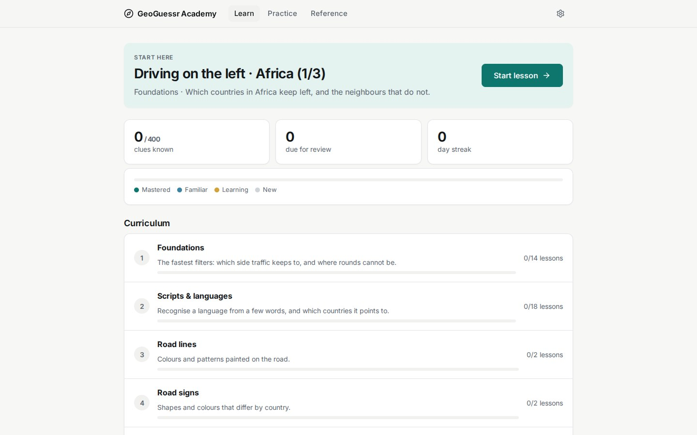
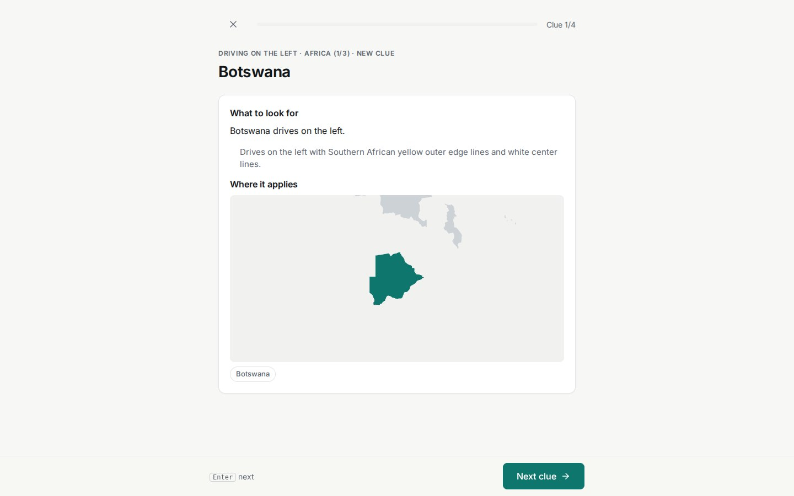

# GeoGuessr Academy

A learning app for recognizing the clues that help you identify places in GeoGuessr, from road markings and signs to languages, license plates, and driving side.

[Open GeoGuessr Academy](https://geo-guesser-practice.ericzwierzynski.dev)





## How it works

**Learn** introduces clues and common mix-ups. **Practice** mixes questions from completed lessons, and **Reference** lets you look up or drill a country. Free Spaced Repetition Scheduler (FSRS) schedules review for individual clues. The hosted app stores progress in your browser. The local dev server also writes it to `data/progress.json`.

## Run locally

Use Node.js 24 or later and npm.

```sh
npm ci
npm run dev
```

Open the URL printed by Vite. Use `npm test` to run tests or `npm run build` to build the static app.

[Glossary](GLOSSARY.md) · [Learning strategy](docs/research/learning-strategy.md) · [Spaced review design](docs/adr/0004-fsrs-per-clue-scheduling.md)
